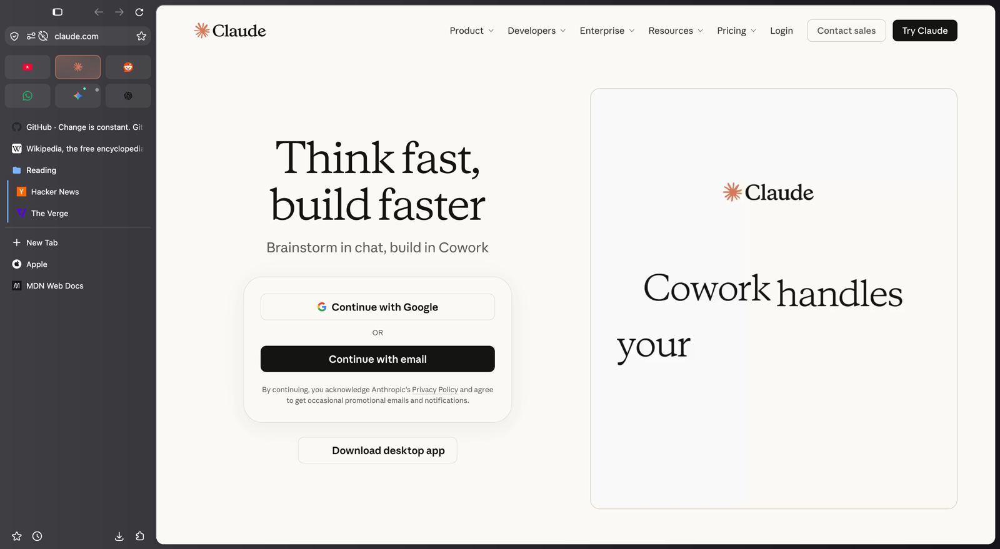
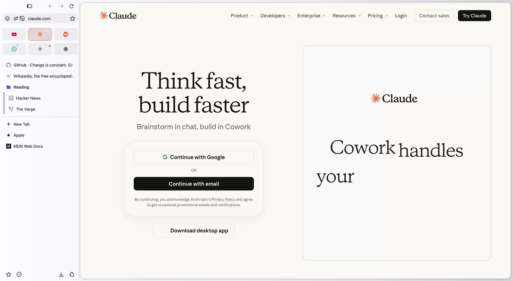
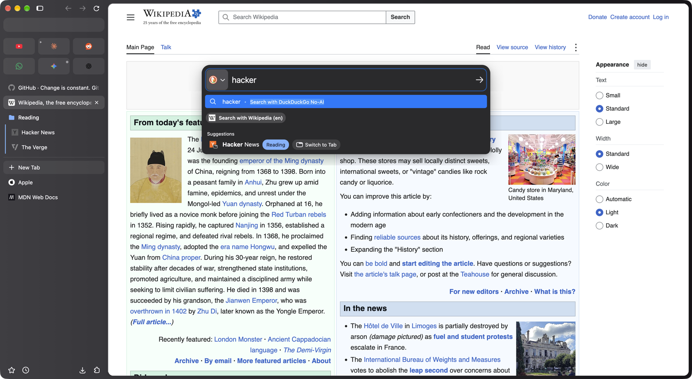
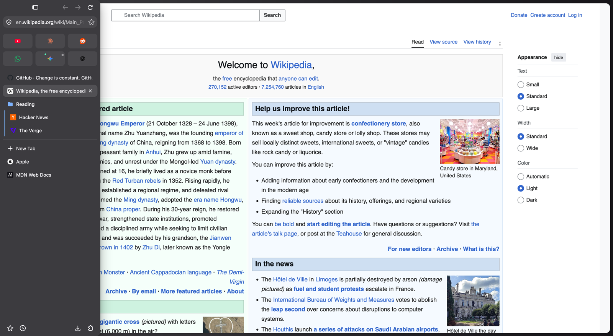

# librewolf-arc

An Arc-style sidebar for [LibreWolf](https://librewolf.net) on macOS, designed to feel as if Apple had made it.

LibreWolf's native vertical tabs become an Arc sidebar: the toolbar and URL bar live at the top of the sidebar, favorite **tiles** and **pinned rows** (with **folders**) sit above a divider, and normal tabs below it. Cmd+T opens a Spotlight-style command bar instead of a blank tab. Everything follows one spacing rhythm, one set of corner radii, fills and shadows, and the system accent color.



| Light mode | Cmd+T command bar | Auto-hide sidebar |
|---|---|---|
|  |  |  |

It's two pieces:

- **`userChrome.css`**: the whole look (layout, sizes, colors, motion).
- **`arc-shortcut/shortcut.cfg.js`**: the behavior (pinned rows and folders, the command bar, closing rules, tile colors, ...). It runs as a LibreWolf *autoconfig* script, installed into the app by `arc-shortcut/install.sh`.

Built and tested on **LibreWolf 158** (macOS) with the Nova Ash theme, in dark and light mode.

## Features

### Layout
- Toolbar and URL bar on top of the sidebar; the page is a floating card with an 8px gutter on every side.
- Window buttons, then a **sidebar button** (show / auto-hide, same as Cmd+S); back, forward, reload at the right.
- Bottom row: Downloads at the left, the profile switcher in the middle, Extensions at the right (bookmarks and history are in the menu bar). No ☰ menu (everything in it is in the macOS menu bar) and no "Customize sidebar" gear.
- **Auto-hide mode**: the sidebar slides in over the page when the pointer reaches the window's left edge (Apple-style curves); the URL bar then floats in the middle of the window, Spotlight-style. Its color is measured from the pinned sidebar, so it matches with any theme or wallpaper.
- Fullscreen: the sidebar and toolbar keep working when the macOS menu bar slides in.
- Start-up: the tab list appears complete (tiles, rows, folders, icons) with a short fade, instead of popping in piece by piece; the command bar appears straight in the middle (never in the sidebar first).

### Profiles (Arc's Spaces)
- LibreWolf profiles serve as Spaces: each has its own tiles, rows, folders, logins, history and extensions, and its own theme.
- **Profile switcher** in the middle of the sidebar's bottom row: the profiles' avatars in their colors (the current one ringed; hovering one lights it up on a soft round fill, with its name), as many as fit. Click one to bring its window forward (or start it). Shown once there are two profiles.
- New profiles are made from LibreWolf's Profiles menu. On a profile's first run, if it doesn't have the look yet, its `chrome` folder is linked to this repo (`install.sh` records where it is) and the settings that load it are turned on; a bar offers to restart, since the look loads at startup.
- Any profile's first run with the script gives it, once, the settings the layout relies on (no bookmarks toolbar, a blank start page, no new tab page content); what you change afterwards stays.

### Tiles, pinned rows and folders (Arc's favorites and pinned tabs)
- **Tiles** (Cmd+Shift+D): LibreWolf's pinned tabs, shown as a grid of icon tiles, in both sidebar modes. Like the pinned rows, they come back unloaded at launch and load when opened (`browser.sessionstore.restore_pinned_tabs_on_demand`).
- **Pinned rows** (Cmd+D): normal tabs kept above the divider; saved and reopened (unloaded) at every launch.
- **Folders**: LibreWolf's tab groups, kept in the pinned block, styled like Arc's.
- Arc-style drag and drop between tiles, rows, folders and normal tabs, with live cues: a tab dropped on the tiles becomes a tile right where it's dropped (the tiles slide aside to make room, the grid grows a line if needed); a folder folds up while it's dragged without the list below jumping; whatever moves when a drop lands glides there. No tab preview cards during drags. A tab dropped on the page goes back where it was (or splits, see below) instead of tearing off into a new window; only a drop outside the window does that, as in Arc and Safari. Drags may wander anywhere (over the page, in and out of the sidebar) and come back.
- **Every window shows the same tiles, rows and folders**, kept in sync: pin, reorder, rename or remove in one window and the others follow (each window has its own copy of the pages, unloaded until opened). Private windows keep to themselves.
- **Pinned page**: each row and tile remembers the page it was pinned on. A dot shows when it's somewhere else; clicking the dot (or Cmd+W, or the right-click menu) goes back. One-time bot-check addresses (Reddit, Cloudflare) are ignored.
- **Tile colors** (as in Zen): the selected tile takes its icon's colors, as a soft gradient with a hairline in the main color.
- Tiles keep their icon while loading, show sound badges as a quiet corner icon, and have no close button.

### New tab = command bar
- Cmd+T and + New Tab open the floating URL bar instead of creating a tab; the tab is created only when Enter loads something (picking an open tab switches to it). Esc, clicking away or pressing again closes it.
- Launch and new windows start with that bar over an empty page instead of a blank tab.
- No stray blank tabs: double-clicking empty sidebar space does nothing; Cmd+W on the empty page does nothing.

### Split view (as in Arc)
- Drag a tab from the sidebar (or from another window) onto the page: the left or right half lights up, and dropping there opens the tab side by side with the page you were on (LibreWolf's own split view underneath). LibreWolf's right-click "Add Split View" / "Open in Split View" work too.
- The two pages are two cards 8px apart; the active one has a thin accent ring, the other shows its address in its corner. In the sidebar the pair is one row, like a macOS segmented control: same height and edges as the rows, a soft fill while it's on screen, a stronger inset fill on the page with the focus.
- **Pinned rows can be split**: the pair sits in the row's spot (inside its folder, too). Only the row is saved; the normal tab next to it is a guest that goes back down to the normal tabs when the two are separated. Two rows split together each keep their own place.
- Cmd+W on a row in a split: the row leaves the pair and resets as usual; the other page stays open. Closing either half shows the other one.
- A split of normal tabs comes back after a restart (when LibreWolf restores your tabs); a row comes back on its own.
- Tiles stay out: LibreWolf can't put its pinned tabs in a split view.

### Peek (as in Arc)
- A link to another site clicked in a tile or a pinned row opens in a card floating over the pinned page (dimmed), instead of replacing it. Links within the same site navigate as usual.
- **Option+click** any link, in any tab, to open it in Peek (as in Zen).
- The card grows out of the link you clicked once its page has drawn (a small spinner at the link while it loads), and shrinks back into it when closed; Open as Tab grows it to the whole page.
- The card has buttons above its top-right corner: **Open as Tab** (keep it as a normal tab), **Open in Split View** (side by side with the page underneath; not from a tile) and **Close**.
- Esc, a click on the dimmed page, Cmd+W or switching to another tab closes it; the page is then gone (it's in Recently Closed).

### Closing
- Closing a row or tile resets it (back to its pinned page, unloaded) instead of closing it.
- After closing a row, a tile or the last normal tab you go to the most recently used open row, else the empty page with the bar, never to an unloaded row that would start loading.

### Auto-archive (as in Arc)
- Normal tabs left unused for 24 hours close by themselves, quietly. They're in LibreWolf's recently closed tabs (Cmd+Shift+T, or History → Recently Closed Tabs), form contents included.
- Never touched: tiles, pinned rows and folders, the current tab, and tabs playing sound, in picture-in-picture, sharing the camera/mic/screen or still loading.
- Change the time in `about:config` → `arc.archiveAfterHours` (hours; `0` turns it off).

### Polish
- macOS sidebar typography (13px) on 32px rows with 4px gaps; 40px tiles 8px apart; every icon and title on shared columns.
- Menus as macOS menus; dialog-like panels (Translate, Edit Bookmark) as macOS popovers.
- One set of design tokens at the top of `userChrome.css` (`--arc-*`): spacing, radii, fills, shadows, motion. Changing a size there updates every derived spacing.

## Keyboard

| Shortcut | Does |
|---|---|
| Cmd+S | Show / auto-hide the sidebar (was Save Page) |
| Cmd+T | Open the command bar (a new tab once you press Enter) |
| Cmd+D | Make the current tab a pinned row, or a normal tab again (was Bookmark Page) |
| Cmd+Shift+D | Make the current tab a tile, or not (was Bookmark All Tabs) |
| Cmd+W | On a row or tile: reset it to its pinned page. On a normal tab: close it |
| Cmd+Shift+C | Copy the page's address ("Link Copied"); was the developer tools' element picker (Cmd+Option+C still opens them) |
| Cmd+1…9 | Go to the tiles in order, then on to the pinned rows |
| Option+click a link | Open it in Peek |
| Esc | Close the command bar, or a Peek |

## Install

1. In `about:config`, set:
   - `toolkit.legacyUserProfileCustomizations.stylesheets` = `true` (loads `userChrome.css`)
   - `sidebar.revamp` = `true` and `sidebar.verticalTabs` = `true` (native vertical tabs)
2. Put this repo's contents in your profile's `chrome` folder (`about:support` → Profile Folder → Open; create `chrome` if it's missing). Cloning straight into it works:
   ```bash
   git clone https://github.com/GiacomoPiergentili/librewolf-arc.git "<profile folder>/chrome"
   ```
3. Install the script into LibreWolf.app. macOS requires the **App Management** permission for this: give it to Terminal in System Settings → Privacy & Security → App Management, then in Terminal:
   ```bash
   "<profile folder>/chrome/arc-shortcut/install.sh"
   ```
4. Quit LibreWolf (Cmd+Q) and reopen it.

**After every LibreWolf update, run `install.sh` again**: updates replace the app, including the config file the script lives in (the CSS keeps working without it, the behavior doesn't). When the script isn't running, a notice at the bottom of the sidebar says so.

To remove the script: `install.sh uninstall`, then restart. To remove the look: delete or rename `userChrome.css`.

## How it works

| File | What it is |
|---|---|
| `userChrome.css` | All styling. Design tokens at the top; sections for the sidebar, tabs, tiles, rows/folders, URL bar, menus and panels, auto-hide, motion, fullscreen. |
| `arc-shortcut/shortcut.cfg.js` | The script, appended to `LibreWolf.app/Contents/Resources/librewolf.cfg` by the installer. Runs once per browser window. |
| `arc-shortcut/install.sh` | Installs / updates / removes the script block in the app's `librewolf.cfg` and the pref file below. |
| `arc-shortcut/arc-shortcut-prefs.js` | Disables the autoconfig sandbox so the script can reach browser windows. |

The script keeps its state in prefs and session data: tiles in the pref `arc.tiles` and pinned rows and folders in `arc.pinnedRows` (the shared list every window follows; each item has an id, `arc-id` on its tabs), the auto-archive time in `arc.archiveAfterHours`, the measured sidebar colors in `arc.sidebarColor.dark` / `.light`, each tab's pinned page in the session value `arc-pinned-page`. The CSS reacts to attributes the script sets (`[arc-pinned-row]`, `[arc-away]`, `[arc-newtab-bar]`, `[arc-start-page]`, `[arc-tile-colored]`, ...).

Some of LibreWolf's UI lives in shadow DOM that `userChrome.css` can't reach (`::part()` is ignored in this build); where needed, the script injects small style blocks there (the sidebar's bottom buttons, the tile grid).

## Tests

```bash
python3 tests/run_tests.py
```

Launches LibreWolf with a fresh, throwaway test profile that uses this repo's `userChrome.css` (your own profile is never touched), drives it through Marionette and checks: layout and spacing, tile colors, the Cmd+T bar, shortcuts, closing rules, tiles in auto-hide mode, the sidebar color measurement, split view by drag and drop, rows and folders across a restart, auto-archive, and the same sidebar in several windows. Takes about a minute; prints PASS/FAIL per check and exits with 1 on any failure. Needs the script installed (`install.sh`); Python 3 standard library only. Run it after changes and after every LibreWolf update.

## What's been done

Built over October 20–21, 2026, from a plain LibreWolf with vertical tabs:

1. **Arc layout**: toolbar and URL bar moved into the sidebar, floating page card, Apple-style colors, shadows, radii and motion; auto-hide sidebar with a Spotlight-style floating URL bar; fullscreen support.
2. **Tiles, pinned rows and folders**: Cmd+D / Cmd+Shift+D, saved and restored rows and folders, Arc-style drag and drop, pinned pages with the away dot and reset-on-close.
3. **Buttons**: sidebar button, back/forward/reload top right, Downloads and Extensions in the bottom row, ☰ and the sidebar gear removed, one icon-button style everywhere.
4. **Command bar for new tabs**: Cmd+T / + New Tab, launch and new windows open the bar instead of a blank tab, no stray blank tabs.
5. **Closing rules**: resets instead of closes for rows and tiles; never landing on (and loading) an unloaded row.
6. **Tile colors** (Zen-style), tile hover, icons kept while loading, quiet sound badges.
7. **Spacing audit**: everything on whole pixels and one rhythm; later a "roomier" density (32px rows, 40px tiles) with all spacings derived from two gap tokens.
8. **Full audit**: dead code and stale comments removed, dialog panels restyled as popovers, and bugs fixed: folders lost at every launch, a 2px drag offset, a black tile after Cmd+W (a stale "visually selected" state), tiles turning into rows in auto-hide mode.

9. **Update safety and shortcuts**: a sidebar notice when the script isn't running (after a LibreWolf update); Cmd+Shift+C copies the page address with a "Link Copied" confirmation; Cmd+1…9 go to the tiles, then the pinned rows.

10. **Auto-archive**: normal tabs unused for 24 hours close by themselves (`arc.archiveAfterHours`).
11. **Light mode pass**: the auto-hide sidebar now matches the pinned one in light mode too (its light color was a guess); + New Tab uses the rows' text color in every theme.

12. **Screenshots and license**: README screenshots (dark, light, command bar, auto-hide); MIT license.
13. **Auto-hide sidebar color**: measured from the pinned sidebar on theme, appearance and wallpaper changes (`arc.sidebarColor.dark` / `.light`).
14. **Video fullscreen, accessibility, tests**: videos fill the screen; the custom buttons have VoiceOver names; a regression test suite, which right away caught fresh installs fitting only 2 tiles per row (the sidebar's contents were narrower than the sidebar until its edge was dragged once).
15. **Multiple windows**: every window shows the same tiles, rows and folders, kept in sync (as in Arc).
16. **Split view by drag and drop** (as in Arc): drop a tab on the left or right half of the page to see both side by side.
17. **Split view, every way in**: all 27 ways a split can start were tested; pinned rows can now be split (the pair stays in the row's spot, the saved list never changes), LibreWolf's "choose a tab" picker and restored split views work (our new-tab handling used to pull their tabs out), tabs can come from another window, and Cmd+Shift+D to un-tile puts the tab below the rows instead of above them.
18. **Drag and drop, checked with real mouse drags** (recorded frame by frame, positions logged every 30ms): fixed tiles dropped at the end instead of where they're dropped, the tiles not making room, the rows opening a stray slot, the list jumping when the tile grid shrinks or a folder is dragged (our CSS overrode LibreWolf's own offsets twice over), a split pair dragged into the rows snapping back, a tab dropped on the page left drawn 23px off in its pair, preview cards popping up mid-drag, and a tile shown as a row with its title against the icon.
19. **Drag torture test** (random circles in and out of the sidebar, detours over the page, every kind of item, checked against a list of invariants afterwards): a drag that left the sidebar was treated as over, so coming back left tabs squeezed and fighting LibreWolf's own drag state; a tab dropped on its own page was torn off into a new window; a tile dropped inside a folder landed outside it.
20. **Peek** (as in Arc): links to other sites from tiles and pinned rows open in a floating card over the pinned page; open as tab, split, or close.
21. **Start-up**: recorded at 60 fps: a stray "New Tab" row, blank tiles and icons arriving one by one for about a second. Tiles now come back unloaded (loading three heavy sites at launch was most of the wait), and the tab list stays hidden until it's complete, then fades in.
22. **Profile switcher**: LibreWolf profiles as Arc's Spaces, switched from the bottom of the sidebar; new profiles get this look on their first run.

Plans and known gaps: see [TODO.md](TODO.md).

## License

[MIT](LICENSE): free to use, change and share, with the copyright notice kept.
